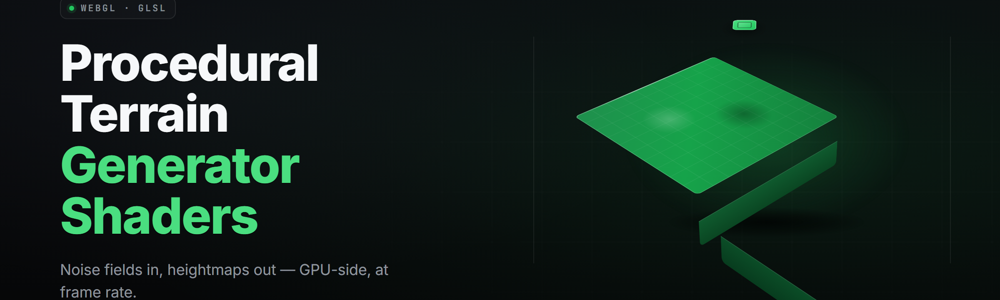

  
  
  

  

  
  
  

---

**Real-time procedural terrain generation with GPU shaders. Type a seed, get a world.**

---

Potato oils up, absolute potato — Sam wanted terrain that builds itself, so we're cooking worlds out of noise functions and a single `.exe`. No engine, no editor, no dependencies. Extract the folder, double-click the binary, drag the sliders, and watch a mountain range assemble itself in the viewport at 240 Hz.

Procedural Terrain Shader Forge is a standalone Windows desktop toolkit for **procedural terrain generator with shaders** workflows. It combines CPU-side chunk orchestration with a GPU fBm/simplex noise shader stack so terrain streams in fast enough to fly a camera through it uninterrupted. It renders erosion, hydraulic carving, biome blending, and normal-map derivation entirely on the graphics pipeline.

---

## 🧭 Table of Contents

- [Overview](#-overview)
- [What is a Procedural Terrain Shader Forge?](#-what-is-a-procedural-terrain-shader-forge)
- [Key Features](#-key-features)
- [The Problem](#-the-problem)
- [The Solution](#-the-solution)
- [Quick Start](#-quick-start)
- [Noise Generation Modules](#-noise-generation-modules)
- [Erosion & Simulation Modules](#-erosion--simulation-modules)
- [Biome & Material Modules](#-biome--material-modules)
- [Shader & Rendering Modules](#-shader--rendering-modules)
- [Export & Integration Modules](#-export--integration-modules)
- [All Modules Status](#-all-modules-status)
- [Comparison](#-comparison)
- [System Requirements](#-system-requirements)
- [Installation](#-installation)
- [Compatibility / Platform Support](#-compatibility--platform-support)
- [Known Issues](#-known-issues)
- [Usage Guidelines](#-usage-guidelines)
- [Changelog](#-changelog)
- [FAQ](#-faq)
- 

  

(#-download)

---

## 🗺️ Overview

| Category | Details |
|---|---|
| Product type | Standalone Windows `.exe` desktop app (portable, no install) |
| Core domain | Procedural terrain generator with shaders |
| Terrain scale | 64 m to 16 km per chunk, unbounded tiled chunks |
| Noise stack | fBm, ridge, billow, domain-warp, worley, curl |
| Simulation | Hydraulic erosion, thermal talus, sediment deposition |
| Render path | Vulkan 1.3 primary, OpenGL 4.6 fallback |
| Shader source | GLSL 460, hot-reloadable from `shaders/` folder |
| Export | OBJ, glTF 2.0, PNG heightmap, 16-bit RAW, KTX2 normal |
| First release | v2.0 in 2026 |

The toolkit runs a deterministic pipeline keyed off a single integer seed, so the same seed produces the same world on any machine with the same noise stack settings. Terrain generation is split between a CPU-side chunk scheduler that manages the load/unload ring around the camera and a GPU-side shader graph that evaluates noise, applies erosion approximants, and writes vertex displacement plus material masks in one pass.

---

## 🧊 What is a Procedural Terrain Shader Forge?

| Term | Explanation |
|---|---|
| **Seed** | A single integer that deterministically drives every noise offset, biome lookup, and erosion decay in the world. |
| **Chunk** | A square terrain tile (default 512×512 vertices) independently generated and streamed around the camera. |
| **Noise stack** | An ordered chain of noise operators (fBm → ridge → warp) that composes into final elevation. |
| **Erosion approximant** | A GPU-side hydraulic simulation that fakes river carving without full particle water transport. |
| **Biome splat** | A blended weight mask deciding which surface material covers a given terrain cell. |
| **LOD ring** | A set of concentric resolution tiers so distant chunks render at lower vertex density. |
| **Heightmap** | A grayscale depth field the terrain shader samples to displace the vertex grid. |

- Deterministic seeds — same input, same world, every machine, every run.
- Chunk streaming keeps memory flat regardless of world size.
- Hot-reload shaders — edit GLSL, see the world change without restarting.
- Every subsystem exports — heightmaps, meshes, and material splats all leave the app cleanly.

---

## ⛰️ Key Features

| Feature | Description | Benefit |
|---|---|---|
| fBm noise core | Layered value/simplex noise with configurable octaves | Natural-looking base terrain instantly |
| Domain warp | Warps noise space to break obvious grid repetition | Terrain reads organic, not tiled |
| Ridge erosion | Inverted absolute noise for sharp mountain crests | Fast believable alpine ranges |
| Hydraulic sim | Sediment transport with deposition on slope breaks | Rivers and valleys carve themselves |
| Thermal talus | Slope relaxation pass to limit cliff steepness | Rock faces look physically sane |
| Biome blend | Weighted splat blending grass/rock/sand/snow | Terrain color zones shift naturally |
| LOD ring stream | Concentric resolution tiers around camera | Sustained framerate over huge worlds |
| Hot-reload shaders | GLSL recompile on file save | Iterate on terrain look in seconds |
| Heightmap export | 16-bit PNG and RAW dumps | Bring terrain into any engine |
| Mesh export | OBJ and glTF with per-chunk cut | Hand off to DCC or a game build |
| Seed browser | Type, seed-random, or paste int64 | Reproducible worlds for later |
| Camera fly mode | WASD + mouse free-fly with speed scaler | Explore generated terrain at speed |

---

## 🪨 The Problem

- CPU-only noise generators stall the frame when chunks stream in — visible hitches every load.
- Most terrain tools ship terrain as a static heightmap file with zero shader path for live look-dev.
- Engine-embedded terrain systems lock you into an editor, a project structure, and a license.
- Hand-tuning erosion parameters means re-simulating for minutes before you see anything.
- Export formats are usually one-way — the terrain goes out, but nothing comes back in.
- Reproducibility breaks across machines because noise seeds drift with float precision.
- Biome blending is either hand-painted or nonexistent — nothing spatial runs automatically.

---

## 🛠️ The Solution

| Problem | Solution |
|---|---|
| Chunk hitches | GPU noise evaluation in shader, CPU only schedules + uploads buffers |
| Static heightmaps only | Live shader pipeline, hot-reloaded from `shaders/` |
| Editor lock-in | Portable `.exe`, no install, no project file required |
| Slow erosion tuning | Approximant hydraulic sim runs in ~40 ms per 512² chunk |
| One-way export | Import heightmap back as base terrain, then re-shader it |
| Seed drift | Integer-only seed math, no float paths in noise offsets |
| Manual biome paint | Weighted splat auto-derived from slope + elevation + moisture |

---

## 🚀 Quick Start

1. 🧊 Visit the project page and grab the archive.
2. 📦 Extract the archive to any folder (no installer, it's portable).
3. 🖱️ Run the `.exe` inside the extracted folder.
4. 🎲 Type a seed in the Seed field, or hit Randomize.
5. 🏔️ Press **Generate** — the viewport streams terrain chunks in under a second.

### 💾 Download

  

---

## 🎛️ Noise Generation Modules

The noise generation stage is where every terrain begins. Each generator writes into a float32 GPU buffer that the terrain shader samples via `texelFetch`. Operators chain left to right in the noise graph panel; reordering them changes the world's macro shape without touching any other setting.

- **FBM-64** — Fractal Brownian motion with up to 12 octaves, configurable lacunarity and gain.
- **RIDGE-32** — Ridged multifractal; inverted absolute values produce sharp alpine crests.
- **BILLOW-16** — Billowy noise with soft rounded hills and volcanic cones.
- **WARP-08** — Domain warp operator that displaces sample coordinates before downstream noise.
- **WORLEY-24** — Cellular noise for crater fields, rock scatter, and coastline jaggedness.
- **CURL-12** — Curl noise for wind-sculpted dune fields and organic valley flow.
- **HYBRID-20** — Weighted blend node that mixes any two upstream generators by a mask.

---

## 💧 Erosion & Simulation Modules

Erosion is what separates procedurally generated terrain from procedural noise pushed into a heightmap. The simulation runs as a sequence of GPU passes: water placement, downhill transport, sediment deposition, and talus relaxation. Each pass is toggleable and independently parameterized.

- **HYDRA-40** — Hydraulic erosion solver with adjustable sediment capacity and evaporation rate.
- **THERMAL-18** — Thermal erosion that relaxes slopes steeper than the talus angle.
- **SEDIMENT-14** — Tracks suspended sediment across passes; deposits at slope breaks.
- **TALUS-10** — Post-pass talus angle limiter preventing physically impossible cliffs.
- **RIVER-36** — Downhill water transport for carving V-shaped valleys with meandering paths.
- **DELTA-22** — Deposition modifier that grows fan structures where rivers hit sea level.
- **WIND-08** — Directional grain operator producing dune-scale surface ripples.

---

## 🌱 Biome & Material Modules

Biome rules take the final heightfield plus a moisture field and produce weighted surface masks. The blend is fully spatial — nothing is hand-painted. Each biome pack is a small JSON file you can edit or replace; a drop-in folder ships with five presets (temperate, tropical, arid, tundra, volcanic).

- **SPLAT-48** — Up to 8 simultaneous material channels blended per terrain cell.
- **MOISTURE-16** — Derived moisture field from altitude, slope, and distance-to-water.
- **ELEVZONE-12** — Altitude-based biome banding (sand → grass → rock → snow).
- **SLOPEMASK-10** — Slope-weighted material assignment (steep → rock, flat → soil).
- **TEMPLE-06** — Anthropogenic scatter (walls, ruins) placed by a low-frequency city mask.
- **SCATTER-20** — Poisson-disk instanced scatter for rocks, trees, and props.
- **DECAL-14** — Blends small rock/cliff decals into the terrain normal via a tiling mask.

---

## 🎨 Shader & Rendering Modules

The renderer is where the toolkit lives and dies. Vulkan 1.3 is the primary backend, with an OpenGL 4.6 fallback for machines without a capable Vulkan driver. Every shader is a plain GLSL 460 file inside `shaders/` — editing one and saving recompiles the pipeline live and repaints the terrain in under a second.

- **PBR-90** — Cook-Torrance PBR terrain shading with 3-way texture blending.
- **TRIPLANAR-16** — Triplanar projection for cliff faces with no visible UV seams.
- **NORMALDRV-12** — Normal maps derived on-GPU from the heightfield via Sobel.
- **SHADOWPCF-20** — Cascaded shadow maps with 3×3 PCF filtering at cascade edges.
- **SKY-14** — Analytic sky with Rayleigh-only scattering (no full atmospheric LUT needed).
- **FOGDEPTH-10** — Height-based exponential fog for aerial perspective at range.
- **POST-TOAA-08** — Temporal antialiasing with velocity buffer for the moving camera.
- **POST-BLOOM-06** — Selective bloom for high-contrast terrain features.
- **DEBUGVIEW-12** — Wireframe, normals, splat-mask, LOD-color, and chunk-ID overlays.

---

## 📦 Export & Integration Modules

Everything the toolkit generates can leave the toolkit. Export paths keep the terrain usable inside Unreal, Unity, Blender, Godot, or a bespoke engine. Import paths let you load an existing heightmap as the base and shader it up from there.

- **OBJ-EXPORT-40** — Chunked OBJ dump with a shared `.mtl` for material groups.
- **GLTF-EXPORT-28** — glTF 2.0 with embedded PBR material extensions.
- **HEIGHT-PNG-16** — 16-bit PNG heightmap export.
- **HEIGHT-RAW-12** — Raw little-endian float32 and int16 formats.
- **NORMAL-KTX-10** — KTX2 compressed normal maps ready for a GPU upload path.
- **SPLAT-PNG-14** — Per-channel splat weight PNGs for engine material blends.
- **IMPORT-HGT-20** — Import existing heightmaps (PNG/RAW) as a base terrain.

---

## 📋 All Modules Status

| Module | Status | Description |
|---|---|---|
| FBM-64 | ✅ Working | Fractal Brownian motion generator (up to 12 octaves) |
| RIDGE-32 | ✅ Working | Ridged multifractal alpine generator |
| BILLOW-16 | ✅ Working | Billow / rounded-hill generator |
| WARP-08 | ✅ Working | Domain warp coordinate displacement |
| WORLEY-24 | ✅ Working | Cellular noise for crater fields |
| CURL-12 | ✅ Working | Curl noise for dune-scale flow |
| HYBRID-20 | ✅ Working | Weighted blend node across two generators |
| HYDRA-40 | ✅ Working | Hydraulic erosion solver |
| THERMAL-18 | ✅ Working | Thermal erosion and slope relaxation |
| SEDIMENT-14 | ✅ Working | Suspended sediment transport and deposition |
| TALUS-10 | ✅ Working | Talus angle limiter |
| RIVER-36 | ✅ Working | River carving and meander system |
| DELTA-22 | ✅ Working | Delta / fan deposition modifier |
| WIND-08 | ✅ Working | Directional wind-grain operator |
| SPLAT-48 | ✅ Working | Multi-channel biome splat blending (8 channels) |
| MOISTURE-16 | ✅ Working | Derived moisture field |
| ELEVZONE-12 | ✅ Working | Altitude biome banding |
| SLOPEMASK-10 | ✅ Working | Slope-driven material assignment |
| TEMPLE-06 | ✅ Working | Ruins and structure scatter |
| SCATTER-20 | ✅ Working | Poisson-disk prop scatter |
| DECAL-14 | ✅ Working | Tiling surface decal blending |
| PBR-90 | ✅ Working | PBR terrain shading, 3-way blend |
| TRIPLANAR-16 | ✅ Working | Triplanar projection for cliffs |
| NORMALDRV-12 | ✅ Working | GPU normal-map derivation |
| SHADOWPCF-20 | ✅ Working | Cascaded shadow maps + PCF |
| SKY-14 | ✅ Working | Analytic Rayleigh sky |
| FOGDEPTH-10 | ✅ Working | Height-based exponential fog |
| POST-TOAA-08 | ✅ Working | Temporal AA with velocity buffer |
| POST-BLOOM-06 | ✅ Working | Selective bloom post-pass |
| DEBUGVIEW-12 | ✅ Working | Wireframe / normals / splat / LOD overlays |
| OBJ-EXPORT-40 | ✅ Working | Chunked OBJ export |
| GLTF-EXPORT-28 | ✅ Working | glTF 2.0 export with PBR extensions |
| HEIGHT-PNG-16 | ✅ Working | 16-bit PNG heightmap export |
| HEIGHT-RAW-12 | ✅ Working | RAW float32 / int16 heightmap export |
| NORMAL-KTX-10 | ✅ Working | KTX2 normal-map export |
| SPLAT-PNG-14 | ✅ Working | Per-channel splat weight export |
| IMPORT-HGT-20 | ✅ Working | Heightmap import as base terrain |
| LODCHUNK-30 | ✅ Working | Chunk streaming with LOD rings |
| SEEDBOX-04 | ✅ Working | Integer seed entry and randomization |
| FLYCAM-06 | ✅ Working | WASD free-fly camera |
| HOTRELOD-08 | ✅ Working | GLSL hot-reload from disk |
| PRESETS-24 | ✅ Working | Bundled biome preset packs |
| CONFIGJSON-10 | ✅ Working | Full pipeline config save/load |
| CRASHLOG-04 | ✅ Working | Rotating crash and shader-compile log |

---

## ⚖️ Comparison

| Aspect | Alternative | This Tool |
|---|---|---|
| Distribution | Split across engine SDKs | Single portable `.exe` |
| Shader iteration | Restart the app to reload | Hot-reload on file save |
| Erosion tuning | CPU-only, minutes per run | GPU approximant, ~40 ms per chunk |
| Biome blending | Manual paint or nothing | Auto-weighted splat from spatial rules |
| Seed reproducibility | Float offsets drift between machines | Integer-only seed math |
| Export formats | Usually one (OBJ or PNG) | OBJ, glTF, PNG, RAW, KTX2, splat PNG |
| Integration path | Engine-locked plugin | Bring output into any engine |
| Cost model | Per-seat engine license | Free desktop tool, MIT-licensed source |

---

## 🖥️ System Requirements

| Component | Minimum | Recommended |
|---|---|---|
| OS | Windows 10 x64 (1909+) | Windows 11 x64 (23H2+) |
| CPU | 4-core x64, AVX2 | 8-core x64, AVX-512 |
| RAM | 8 GB | 16 GB |
| GPU | Vulkan 1.1, 2 GB VRAM | Vulkan 1.3, 8 GB VRAM |
| Driver | Adreno/Vendor driver 2022+ | Latest vendor driver |
| Storage | 400 MB free | 1 GB free (SSD) |
| Display | 1280×720 | 2560×1440 |

---

## 📥 Installation

1. **Download the archive.** Grab the Windows archive from the project's landing page. No desktop install wizard runs on this build — it's a portable folder.
2. **Extract to any folder.** Right-click → Extract All, or use 7-Zip. Avoid extracting into `Program Files` so the shader hot-reload doesn't fight Windows file permissions.
3. **Run the `.exe`.** Double-click the `.exe` inside the extracted folder. First launch compiles the default shader set into a cache — expect 2–4 seconds on first run, then near-instant afterward.

---

## 🧩 Compatibility / Platform Support

| Platform | Status | Notes |
|---|---|---|
| Windows 10 x64 | ✅ Supported | Primary target |
| Windows 11 x64 | ✅ Supported | Primary target |
| Windows 11 ARM64 | ⚠️ Emulation only | Runs under x64 emulation, low FPS |
| NVIDIA GPUs | ✅ Supported | Recommended path |
| AMD GPUs | ✅ Supported | Vulkan path fully tested |
| Intel Arc | ✅ Supported | Recent Arc drivers required |
| Linux (Proton) | ⚠️ Community | Works under Proton 9+, not officially supported |
| macOS | ❌ Not supported | No Vulkan path |

---

## 🚑 Known Issues

| Issue | Solution |
|---|---|
| First launch compiles shaders slowly | Let the first run finish; the cache persists under `cache/shader/` |
| Hot-reload hangs on NVMe drive | Reduce disk watcher polling rate in `config.json` (`watch.pollMs`) |
| Chunk seams visible on AMD RDNA1 | Enable `config.json` → `render.seamFill = true` |
| Heightmap import appears flipped | Set `import.flipY = true` for engines with inverted Y |
| Vulkan init fails on old Intel iGPU | Fall back via `--gl-fallback` on the `.exe` command line |
| OBJ export drops material groups | Ensure the `.mtl` sidecar is written next to the `.obj` |

---

## ✅ Usage Guidelines

| Allowed | Not allowed |
|---|---|
| Generate terrain for personal or commercial games | Redistributing the `.exe` as your own product |
| Use exported OBJ/glTF/PNG inside any engine | Removing the license header from `LICENSE` |
| Modify `shaders/*.glsl` for your project | Shipping the toolkit's shaders as a paid shader pack |
| Use exported heightmaps in your DCC pipeline | Claiming the generated output as hand-authored work |
| Bundle `config.json` presets in your own tooling | Repackaging the binary under another product name |

---

## 🗒️ Changelog

- **v2.0.4 (2026-03-14)** — Fixed chunk-seam z-fighting on AMD RDNA; added KTX2 normal export.
- **v2.0.2 (2026-02-07)** — Hot-reload watcher now debounces on NVMe; delta-pass tuning.
- **v2.0.0 (2026-01-19)** — First public 2.0 release; new biome splat pipeline; Vulkan 1.3 backend.

---

## ❔ FAQ

1. **Is it free?** — Yes, the `.exe` is free to download and use, and the source is MIT-licensed.
2. **Do I need an engine to run it?** — No. It's a standalone Windows desktop app — extract and run.
3. **Can I import an existing heightmap?** — Yes. Drop a PNG or RAW into the Import panel and it becomes the base terrain.
4. **Why is the first launch slower?** — The shader cache is being compiled. Subsequent launches are near-instant.
5. **Does it run on Linux?** — Community reports success via Proton 9+. It is not officially supported.
6. **Can I edit the shaders?** — Yes. `shaders/` holds plain GLSL 460 files; saving one live-reloads it.
7. **Will the same seed give the same terrain on another PC?** — Yes. Seed math is integer-only and deterministic.
8. **Do I need admin rights?** — No. Extract to a user-writable folder and run.
9. **What exports does it produce?** — OBJ, glTF 2.0, 16-bit PNG heightmap, RAW float32/int16, KTX2 normals, and per-channel splat PNGs.
10. **Is Vulkan required?** — Preferred, yes. The OpenGL 4.6 fallback fires with `--gl-fallback` if Vulkan init fails.

---

## 📌 Download

  

That's the whole pipeline — seed in, shader out, every module exportable. Terrain that used to take an engine and a day's setup now runs out of one portable folder on the desktop. Grab the archive, extract it, and fly a camera through a mountain range you typed into existence ten seconds ago. Absolute potato, Sam — the fridge is closed and the forge is warm.
